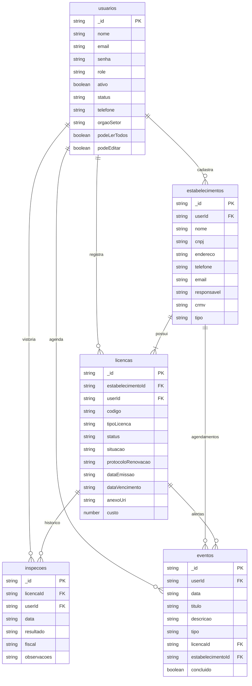
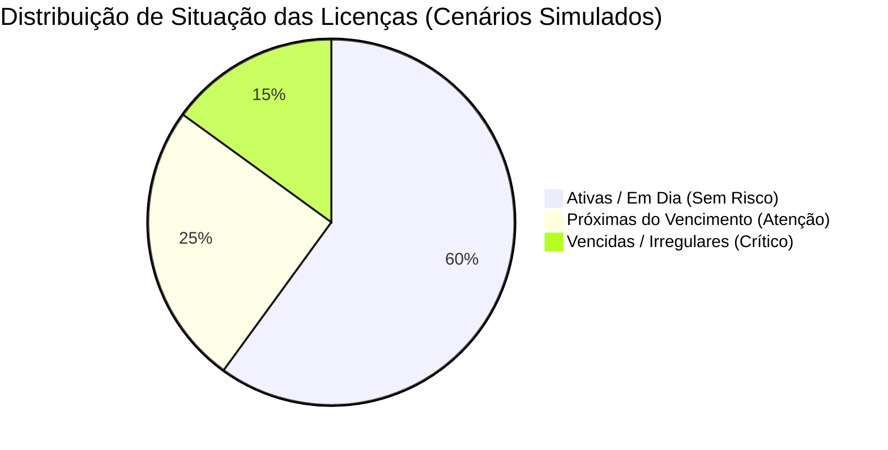

```mermaid
flowchart LR
    %% Estilos de cores padronizados
    classDef cicd fill:#EDE7F6,stroke:#5E35B1,stroke-width:2px,color:#311B92;
    classDef edge fill:#E1F5FE,stroke:#0288D1,stroke-width:2px,color:#01579B;
    classDef client fill:#E0F2F1,stroke:#00796B,stroke-width:2px,color:#004D40;
    classDef backend fill:#FFF3E0,stroke:#F57C00,stroke-width:2px,color:#E65100;

    %% 1. CI/CD
    subgraph CI_CD ["1. Integração Contínua (CI/CD)"]
        direction TB
        DEV["Desenvolvedor<br/>(Repositório Git)"]
        GHA["GitHub Actions<br/>(Testes Vitest & Build)"]
        DEV -->|"git push"| GHA
    end

    %% 2. Edge / Hospedagem
    subgraph EDGE ["2. Borda & Distribuição"]
        direction TB
        CF["Cloudflare Pages<br/>(CDN Global & Cache Edge)"]
        SPA["Roteamento SPA<br/>(Baixa Latência)"]
        CF --- SPA
    end

    %% 3. Frontend
    subgraph FRONTEND ["3. Camada Cliente (Frontend Web)"]
        direction TB
        UI["Interface do Usuário<br/>(React 19 + Tailwind CSS)"]
        STORE["Estado & Rotas<br/>(Zustand + React Router)"]
        SDK["Cliente Convex SDK<br/>(Reatividade Client-Side)"]
        UI --- STORE --- SDK
    end

    %% 4. Backend Serverless
    subgraph BACKEND ["4. Backend Serverless (Convex Cloud)"]
        direction TB
        WS["Gateway WebSocket<br/>(Subscrições em Tempo Real)"]
        FN["Funções Serverless<br/>(Queries & Mutations)"]
        DB[("Banco de Dados Reativo<br/>(Documentos & Índices)")]
        WS --- FN --- DB
    end

    %% Conexões entre camadas
    GHA -->|"Deploy Automatizado"| CF
    CF -->|"Entrega dos Assets"| UI
    SDK <===>|"Sincronização em Tempo Real"| WS

    %% Aplicação de classes
    class DEV,GHA cicd;
    class CF,SPA edge;
    class UI,STORE,SDK client;
    class WS,FN,DB backend;
```

O erro ocorreu porque os blocos de código estavam aninhados (um bloco de Markdown envolvendo o bloco do Mermaid), o que fez o leitor do GitHub interpretar o texto comum como se ainda fosse código do diagrama.

Abaixo estão os diagramas separados, **prontos para copiar individualmente** (sem blocos aninhados):

---

### Figura 1 – Arquitetura do Sistema SIGS

Copie exatamente o bloco abaixo:

**Fonte:** Elaborado pelos autores (2026).

---

### Figura 6 – Diagrama Entidade-Relacionamento (Modelo de Dados do Convex)

Copie exatamente o bloco abaixo:

**Fonte:** Elaborado pelos autores (2026).

---

### Figura 7 – Distribuição de Status de Licenças (Cenários de Teste)

Copie exatamente o bloco abaixo:

**Fonte:** Elaborado pelos autores (2026).
